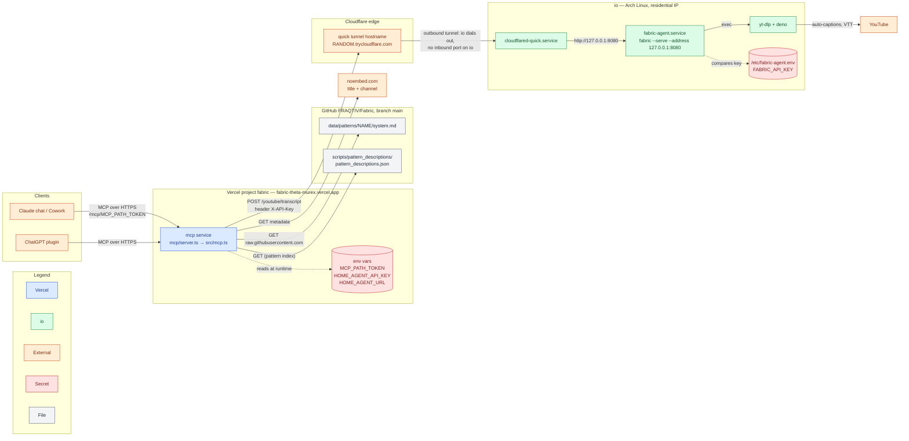
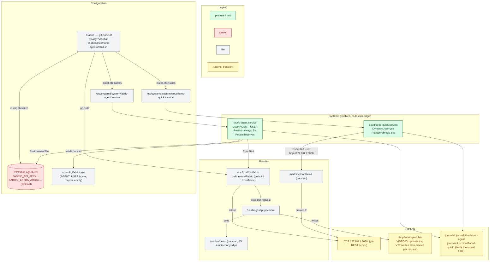
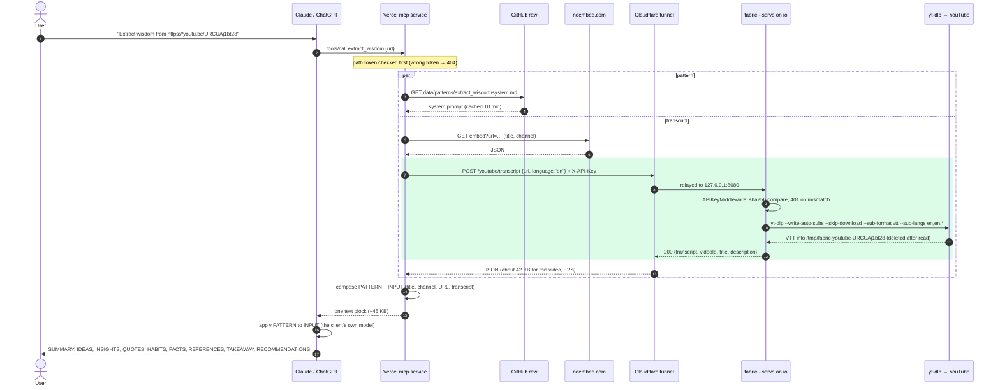
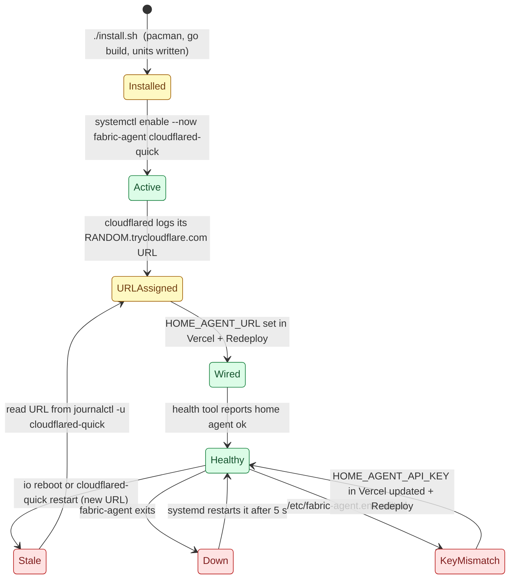
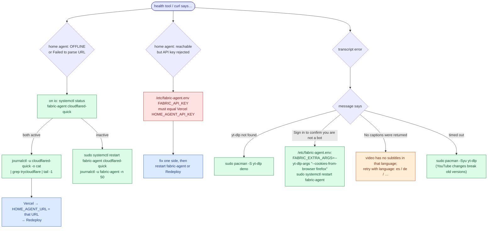

# Fabric on `io` — how the transcript agent works

Reference for humans and for AI sessions running on `io` (Arch Linux). Everything here is the
actual deployment: real hostnames, real paths, real unit names. Secrets are named, never written out.

Color legend used in every diagram:

| Color | Meaning |
| --- | --- |
| Blue | runs on Vercel (cloud) |
| Green | runs on `io` |
| Orange | external service (Cloudflare edge, YouTube, GitHub, Claude/ChatGPT) |
| Red | secret — value lives only in the named store |
| Grey | file on disk |

## 1. Architecture — who talks to whom



Key facts:

- `io` never accepts inbound connections. `cloudflared` opens an outbound connection to Cloudflare and
  requests are relayed back down it to `127.0.0.1:8080`.
- Access control is two keys: the path token on the Vercel URL, and `X-API-Key` on the hop into `io`.
- No LLM runs anywhere in this chain. The client model (Claude or ChatGPT) applies the pattern.

## 2. Files and processes on `io`



| Path | Owner | Purpose |
| --- | --- | --- |
| `/etc/fabric-agent.env` | root, mode 600 | `FABRIC_API_KEY` (must equal Vercel's `HOME_AGENT_API_KEY`); optional `FABRIC_EXTRA_ARGS` |
| `/etc/systemd/system/fabric-agent.service` | root | runs `fabric --serve --address 127.0.0.1:8080 $FABRIC_EXTRA_ARGS` |
| `/etc/systemd/system/cloudflared-quick.service` | root | runs `cloudflared tunnel --no-autoupdate --url http://127.0.0.1:8080` |
| `/usr/local/bin/fabric` | root | Fabric binary built from the repo clone |
| `~/.config/fabric/.env` | AGENT_USER | Fabric's own config; present but empty is fine (no vendors needed) |
| `~/Fabric` | AGENT_USER | repo clone; `git pull` then re-run `install.sh` to upgrade |

## 3. One request, end to end



Green block = the part that runs on `io`. Timeouts: Vercel waits up to 100 s for the agent
(`TRANSCRIPT_TIMEOUT_MS`); `health` uses 10 s.

Tools the Vercel service exposes: `extract_wisdom(url, language?)`, `apply_pattern(url, pattern, language?)`,
`get_transcript(url, language?, timestamps?)`, `list_patterns(query?)`, `get_pattern(name)`, `health()`.
Only the first three reach `io`.

## 4. Service and tunnel lifecycle (state)



The quick tunnel is the one piece of state that is **not** durable: its hostname is reassigned on
every `cloudflared` start. `fraqtiv.com` cannot host a permanent name because its DNS is at Vercel, not
Cloudflare; a permanent name needs a Cloudflare-hosted domain (see `mcp/home-agent/README.md`).

## 5. Troubleshooting — start from what `health` says



## 6. Commands an AI session on `io` can rely on

```bash
# status and logs
systemctl status fabric-agent cloudflared-quick
journalctl -u fabric-agent -f
journalctl -u cloudflared-quick -o cat | grep -o 'https://[a-z0-9-]*\.trycloudflare\.com' | tail -1   # current tunnel URL

# local proof the agent works (no tunnel involved)
curl -s -X POST http://127.0.0.1:8080/youtube/transcript \
  -H "X-API-Key: $(sudo sed -n 's/^FABRIC_API_KEY=//p' /etc/fabric-agent.env)" \
  -H 'Content-Type: application/json' \
  -d '{"url":"https://youtu.be/URCUAj1bt28","language":"en"}' | head -c 300

# upgrade Fabric to the repo's main
cd ~/Fabric && git pull && cd mcp/home-agent && FABRIC_API_KEY="$(sudo sed -n 's/^FABRIC_API_KEY=//p' /etc/fabric-agent.env)" ./install.sh

# change yt-dlp behaviour
sudo nano /etc/fabric-agent.env && sudo systemctl restart fabric-agent
```

Do not: open port 8080 to the LAN or internet (the tunnel is the only intended path), put the API key
in the repo, or run `fabric --serve` without `--address 127.0.0.1:8080`.

Related: `mcp/README.md` (the Vercel service), `mcp/home-agent/README.md` (runbook and install script),
`mcp/chatgpt-plugin-prompt.md`.
